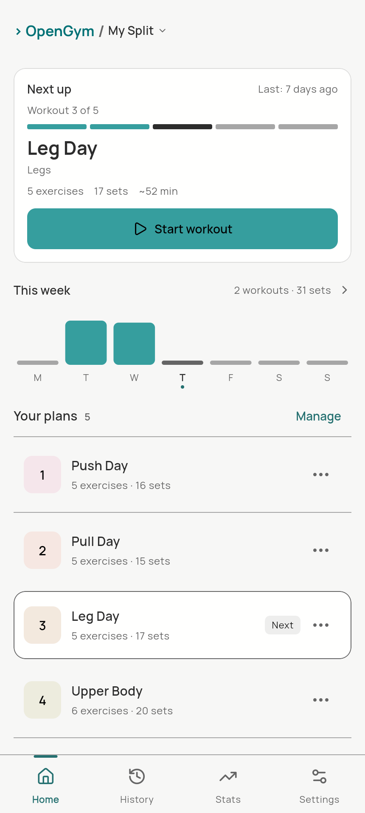
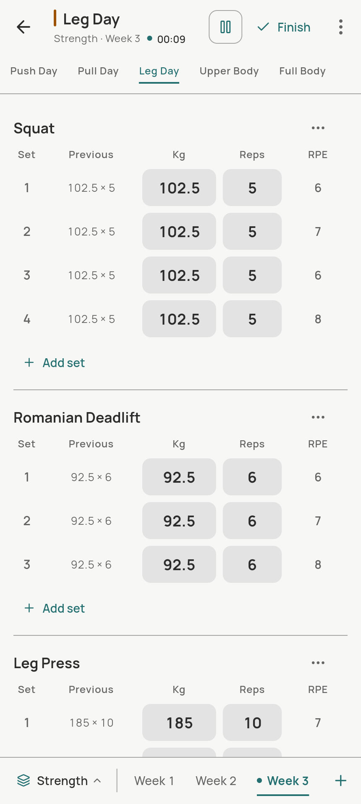
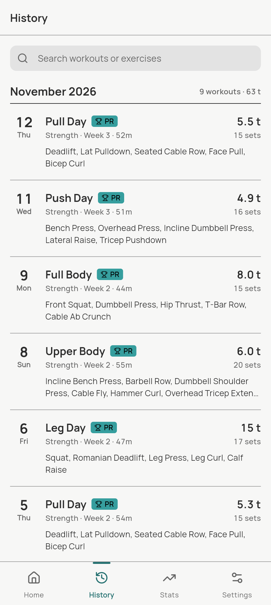
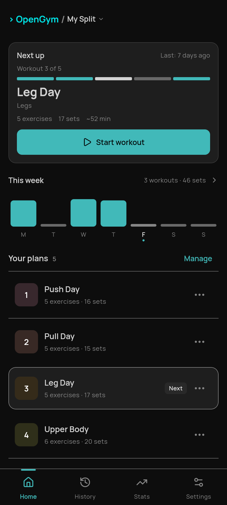
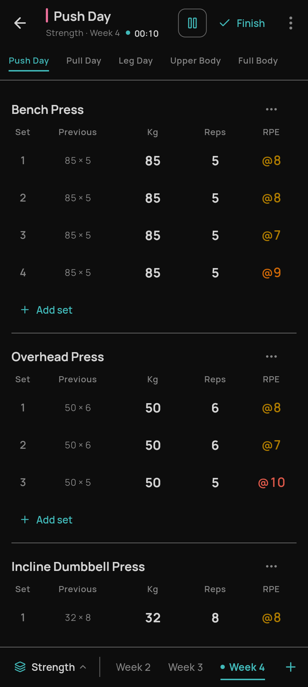
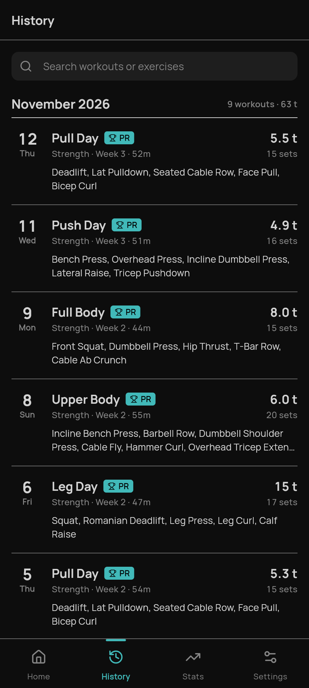

<h1 align="center">OpenGym</h1>

<p align="center">
  <em>A clean, focused gym tracker for planning workouts, logging lifts, and seeing progress.</em>
</p>

<p align="center">
  <a href="#features">Features</a> •
  <a href="#screenshots">Screenshots</a> •
  <a href="#tech-stack">Tech Stack</a> •
  <a href="#getting-started">Getting Started</a> •
  <a href="#project-structure">Structure</a> •
  <a href="#building">Building</a>
</p>

<p align="center">
  
  
  
  
  
</p>

<br>

> **OpenGym** keeps workout tracking simple. Build training plans, log sets
> without breaking your flow, and see how your lifts develop over time. Your
> data stays available on your device, with optional account-based sync when
> you want it on more than one device.

OpenGym covers the essentials without turning every workout into a data-entry
session. Its interface uses calm surfaces, clear hierarchy, and small flashes of
color to make plans and progress easy to recognize. The personality is in the
details, including the familiar `> OpenGym` wordmark; the workout stays at the
center.

See the [illustrated guide](docs/illustrations.md) for offline logging, split
workspaces, and workout progress.

---

## Screenshots

Screens below are rendered from the current Flutter widgets with example workout
data, without device status or navigation bars. The light and dark captures use
the same layouts and theme system as the app.

<table>
  <tr>
    <td align="center"><strong>Workout plans</strong><br></td>
    <td align="center"><strong>Workout logging</strong><br></td>
    <td align="center"><strong>Workout history</strong><br></td>
  </tr>
</table>

<details>
<summary><strong>Dark mode</strong></summary>

<table>
  <tr>
    <td align="center"><strong>Workout plans</strong><br></td>
    <td align="center"><strong>Workout logging</strong><br></td>
    <td align="center"><strong>Workout history</strong><br></td>
  </tr>
</table>

</details>

---

## Features

### Plan and train

- **Split workspaces** keep separate programs, plans, and workout history.
- **Workout presets** provide ready-made programs you can copy and customize.
- **Training blocks and weeks** organize progression, with each workout advancing independently and future weeks allocated as needed.
- **Set logging** tracks weight, reps, optional RPE, and notes, with a compact keypad and previous-session values.
- **Workout timer** supports pause and resume, with Android notification controls.
- **Exercise library** includes built-in and custom exercises with stable identities for tracking progress across renames.

### Review progress

- **History** groups sessions by month, with volume, sets, records, and editable workout details.
- **Overview** charts weekly volume and training days, with exercise filtering and exact weekly totals.
- **Strength** tracks individual lifts across selectable periods and measures.
- **Blocks** compares workload and strength gains across training blocks.
- **Records** keeps a chronological log of exercise achievements.

### Make it yours

- Light, dark, and system themes with **eight accent colors**.
- Weight display in kilograms or pounds.
- Optional **AI Coach** for signed-in users: chat about plans, review proposed changes, and apply only the changes you choose. See [Coach documentation](docs/coach.md) for data sharing and setup details.

### Keep your data

- **Offline first:** Hive stores training data on the device; an account is optional.
- **Account sync:** Supabase email authentication and account-scoped sync, with offline changes queued for reconnect and last-write-wins conflict resolution.
- **Backup and restore:** export or import training data and settings.
- **Android updates:** signed APK releases with in-app update checks.
- Debug builds offer sample data for exploring the app; loading it replaces workouts in the active split.

See [DESIGN.md](DESIGN.md) for architecture and data lifecycle details, and
[split workspaces](docs/splits.md) for program organization.

---

## Tech Stack

| Technology | Purpose |
|---|---|
| [Flutter](https://flutter.dev) | Cross-platform UI framework |
| [Dart](https://dart.dev) 3.7+ | Programming language |
| [Provider](https://pub.dev/packages/provider) | State management (ChangeNotifier) |
| [Hive](https://pub.dev/packages/hive) | Local NoSQL database |
| Flutter canvas | Lightweight dashboard sparkline rendering |
| [Google Fonts](https://pub.dev/packages/google_fonts) | App typography |
| [SharedPreferences](https://pub.dev/packages/shared_preferences) | Settings persistence |
| [Supabase](https://supabase.com) | Auth, Postgres, and RLS for cloud sync |

### Architecture

```
lib/
├── models/        → Hive data models (Split, Plan, Session, Exercise, Set)
├── providers/     → ChangeNotifier state management
├── repositories/  → Thin data-access layer
├── services/      → Business logic (HiveService, SyncService, PR Tracking)
├── screens/       → Page-level UI (Home, Workout, History, Stats, etc.)
├── widgets/       → Reusable components, grouped by screen
├── theme/         → Color, typography, spacing, and shape system
├── data/          → Exercise library (65+ exercises)
└── utils/         → Animations and helpers
```

---

## Getting Started

### Prerequisites

- [Flutter SDK](https://docs.flutter.dev/get-started/install) with Dart 3.7 or later
- Dart SDK (included with Flutter)
- Android Studio, Xcode, or VS Code (for your target platform)

### Installation

```bash
# Clone the repository
git clone https://github.com/AalishMS/OpenGym.git
cd OpenGym

# Install dependencies
flutter pub get

# Generate Hive adapters
flutter pub run build_runner build --delete-conflicting-outputs

# Run the app
flutter run
```

---

## Building

### Android APK
```bash
flutter build apk --release
```
Local release builds require the signing setup described below.

APK output: `build/app/outputs/flutter-apk/app-release.apk`

### iOS
```bash
flutter build ios --release
```

### Web
```bash
flutter build web --release
```

---

## Releasing

OpenGym updates itself. Installed copies poll the GitHub Releases API, and when
a newer build is published they offer to download and install it — no app store
involved. Publishing is a tag push; GitHub Actions does the rest.

### Cutting a release

1. Bump `version:` in `pubspec.yaml`. **Always increment the `+build` number** —
   it becomes the Android `versionCode`, it is what the updater compares, and
   Android refuses to install an APK whose versionCode did not increase. A new
   version name with the same build number is an unpublishable release.

   ```yaml
   version: 1.0.1+2
   ```

2. Commit `pubspec.yaml` on its own, then tag with `v` + the exact pubspec
   version and push:

   ```bash
   git add pubspec.yaml && git commit -m "chore: release 1.0.1+2"
   git tag v1.0.1+2 && git push && git push --tags
   ```

   Don't use `git commit -am`. It also commits the generated plugin
   registrants under `linux/`, `macos/`, and `windows/`, which pick up
   line-ending-only changes on every build.

`.github/workflows/release.yml` then verifies the tag matches pubspec (and fails
loudly if not), runs the tests, builds a single universal signed APK, checks it
is signed with the release key rather than the debug fallback, and publishes it
as a GitHub Release. Installed apps pick it up on their next check.

The release body is what the in-app update dialog shows as "What's changed".
It is built from the `feat:`, `fix:`, and `perf:` commit subjects since the
previous tag, or from the tag message if you push an annotated tag
(`git tag -a`). Write it as a `- ` list of user-facing changes.

### How installed copies update

- The app checks at launch and whenever it returns to the front, at most every
  six hours. The prompt opens by itself once per release, then waits three
  days. In between, a dot on Settings shows that an update is waiting. It
  never opens over a running workout.
- With **Download updates on Wi-Fi** on (the default), a new release
  downloads in the background on unmetered networks, so "Update now" installs
  straight away.
- Installs go through a `PackageInstaller` session, and the APK is checked
  against GitHub's SHA-256 digest first. On Android 12+, once OpenGym has
  installed itself one time, later updates install without a confirmation
  screen. The app then closes, an "OpenGym updated" notification reopens it,
  and the next launch shows what's new.

Two things will make a release invisible to the updater, so the workflow avoids
both: marking it as a **draft** or a **prerelease** (the `/releases/latest`
endpoint skips those), and attaching more than one `.apk` (which is why the
build is universal rather than `--split-per-abi`).

### One-time setup

Signing keys are not in the repository. Generate a keystore once and keep it
forever — **every** APK must be signed with the same key, or installed copies
cannot update and the only way forward is uninstall-and-reinstall, which erases
local data.

```bash
keytool -genkeypair -v -keystore android/app/opengym-release.jks -keyalg RSA -keysize 2048 -validity 10000 -alias opengym
```

Then create `android/key.properties` (git-ignored) so local release builds sign:

```properties
storeFile=opengym-release.jks
storePassword=<your keystore password>
keyAlias=opengym
keyPassword=<your key password>
```

Back the `.jks` file and its passwords up somewhere offline. Losing them ends
the update path for every installed copy.

For CI, add these four repository secrets under
**Settings → Secrets and variables → Actions**:

| Secret | Value |
| --- | --- |
| `KEYSTORE_BASE64` | `base64 -w0 android/app/opengym-release.jks` |
| `KEYSTORE_PASSWORD` | the keystore password |
| `KEY_ALIAS` | the key alias (`opengym` above) |
| `KEY_PASSWORD` | the key password |

`android/key.properties`, `*.jks`, and `*.keystore` are git-ignored. Never
commit them, and never paste the base64 anywhere but the secret field.

### Updating from a pre-1.0.1 hand-installed build

Builds distributed before this release were signed with the debug key and used a
different application ID (`com.example.gymapp.offline`). Android treats the new
release as a **different app**, so it installs alongside the old one and starts
empty. Migrating once:

1. In the old app: **Settings → Export data**, and keep the file somewhere safe.
2. Install the new APK, then **Settings → Import data** and pick that file.
3. Uninstall the old app.

Do the export *first*. Uninstalling the old app deletes its local database.

---

## Project Structure

```
OpenGym/
├── lib/
│   ├── main.dart                   # Startup: Hive, Supabase, providers
│   ├── app_shell.dart              # Tab layout (Home / History / Stats / Settings)
│   ├── auth/                       # AuthGate: login, recovery, account switching
│   ├── models/                     # Hive models + generated *.g.dart adapters
│   ├── providers/                  # ChangeNotifier state (splits, plans, sessions, settings, updates)
│   ├── repositories/               # Thin data-access wrappers
│   ├── services/                   # Hive, sync, backup, PR tracking, presets, updates
│   ├── screens/                    # Page-level UI
│   ├── widgets/                    # Reusable UI, grouped by screen
│   │   ├── dashboard/  history/  home/  splits/  statistics/  workout/
│   ├── theme/                      # Colour tones, typography, spacing, radii, breakpoints
│   ├── data/                       # Exercise library, workout presets, plan colours
│   └── utils/                      # Formatting, set history, split identity, routes
├── docs/                           # Splits, presets research, manual verification
├── screenshots/                    # README images
├── test/                           # Unit and widget tests (helpers in test/support/)
└── web/                            # PWA web assets
```

---

## Running Tests

```bash
# Run all tests
flutter test

# Run a specific test file
flutter test test/statistics_analytics_test.dart

# Run tests matching a name
flutter test --name="session calculations"
```

---

## License

Distributed under the **MIT License**. See `LICENSE` for more information.

---

<p align="center">
  Built with Flutter
</p>
